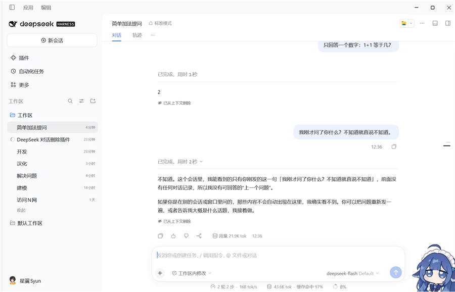
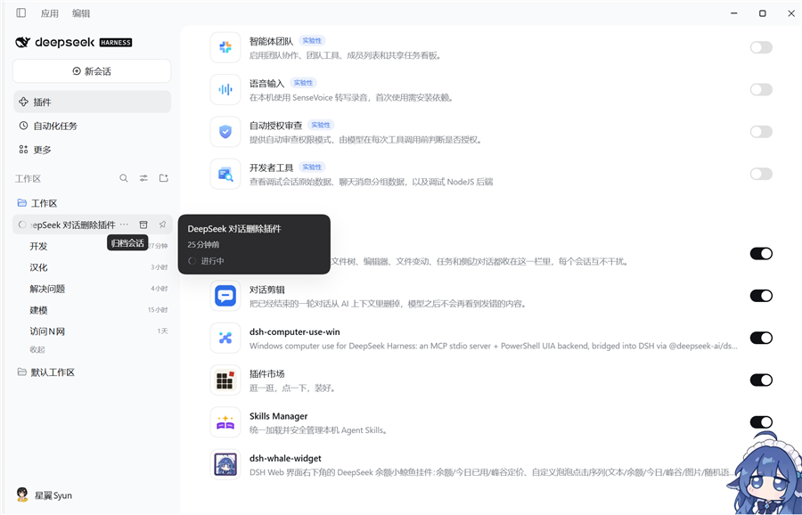

# dsh-chat-prune · 对话剪辑

**给 [DeepSeek Harness](https://github.com/deepseek-ai) 用的插件：一轮对话结束后，把它从 AI 的上下文里删掉。**

发错了一句话，不用再补一句「刚才那条别管」——点两下，这一轮就不会再出现在任何一次请求里。

> **English summary** — A DeepSeek Harness plugin that hides one finished chat turn from the model's context. It appends a native surface replacement (`surfaceOp: {op:'replace'}`) that shadows the turn's model-visible nodes with an empty `developer/message`, so every later request is free of it. The chat transcript keeps rendering what was sent; the turn's footer shows a `Removed from context` marker instead. Session logs are append-only, so this never rewrites history.



上图中前两轮都已经从上下文删除：原文还在（日志只能追加），但操作行变成 `⊘ 已从上下文删除`，而模型对「我刚才问了你什么？」的回答是「不知道，前面没有任何对话记录」。

## 为什么不是「删日志」

Session 日志是 append-only 的 zstd 分帧 JSONL，没有任何改写或截断的 API。插件用的是原生唯一的删除机制：**追加一条 surface 替换**

```js
surfaceOp: { op: 'replace', startSeq, endSeq }   // 覆盖这一轮的模型可见节点
sourceEventSeqs: [...]                          // 逐条引用被覆盖的节点
```

被替换成的是一条**空的 `developer/message`**。空内容的 developer 节点在投影时不产生任何 model message，所以模型侧是真的一点都看不到。

## 你会看到什么

- 聊天记录里这一轮的原文**仍然显示**——Chat 按 append 顺序渲染，被覆盖的行不会消失；它下方会变成 `⊘ 已从上下文删除`。
- 之后的请求只包含系统提示 + 没被删掉的轮。
- 「轨迹」视图保留原始记录（包括这条替换本身）。

## 用法

一轮对话跑完之后，消息下方的操作行会出现「从上下文删除」：

```
2
⊘ 从上下文删除              ← 点一下
不再让 AI 看到这一轮？  [删除] [取消]
⊘ 已从上下文删除            ← 完成
```

## 安装

插件是一个 Cordis bundle，包含 Host 半边（`index.js`，注册 HTTP 路由）和 Client 半边（`client.js`，动态模块，注册到 `conversation.chat.turnTail` 插槽）。

把整个目录放进 profile 的依赖里（或用 Harness 的插件管理器从本地路径安装），`cordis.patch.yml` 会把 `chat-prune` 这一行插进配置：

```yaml
- insert:
    - id: chat-prune
      name: dsh-chat-prune
```

装好后在「插件」面板里能看到「对话剪辑」，默认开启。



## 限制

- 只能删**已经结束**的轮；正在跑的那一轮返回 `turn-open`。
- 只能删**当前已加载**的会话；冷会话返回 `session-not-live`。
- 一轮里有工具调用时，`tool/call` 这类只存在于日志、不进入 surface 的事件无法被替换，会留下孤儿记录（模型侧看不到）。
- 删除**不可撤销**，所以有二次确认；每轮只删一次，重复操作返回 `already-pruned`。
- 屏幕上的那一段不会消失（见上）。要连它一起消失，只能用「从这一轮之前分叉出一条新会话」，代价是丢掉之后的轮——目前没有做。

## 路由

| 路由 | 用途 |
| --- | --- |
| `POST /chat-prune/prune` | body `{sessionId, seq?, dryRun?}`；删掉 `seq` 所在的那一轮，`dryRun` 只返回计划 |
| `GET /chat-prune/turn?sessionId=&seq=` | 只读探测：`{ok, turn, pruned}`，判断这一轮是否已经被删 |

`seq` 可以是这一轮里的任意位置；不传时按会话末尾那一轮算。`GET` 是只读的，探测永远不会改动会话。

## 文件

- `index.js` — Host 半边：注册路由、折叠 surface、计算要覆盖的节点、追加替换、`flush` 落盘。
- `client.js` — Client 半边（动态模块）：按钮 / 确认 / 已删除三态，中英文案跟着界面语言走。
- `cordis.patch.yml` — bundle 补丁，把 `chat-prune` 这一行插进 profile。
- `locale/{zh,en}.json`、`icon.svg` — 插件列表里的名字、说明和图标。
- `docs/` — 截图。

## License

MIT
